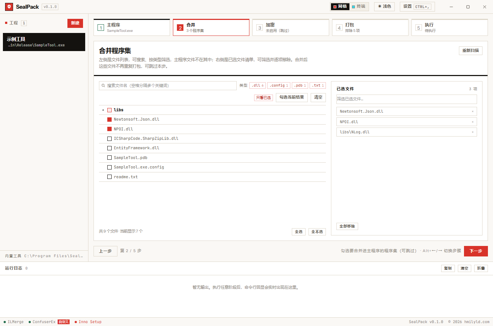
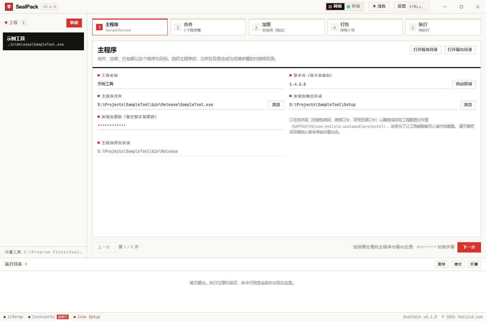
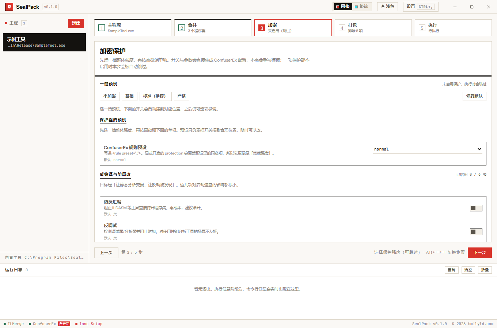
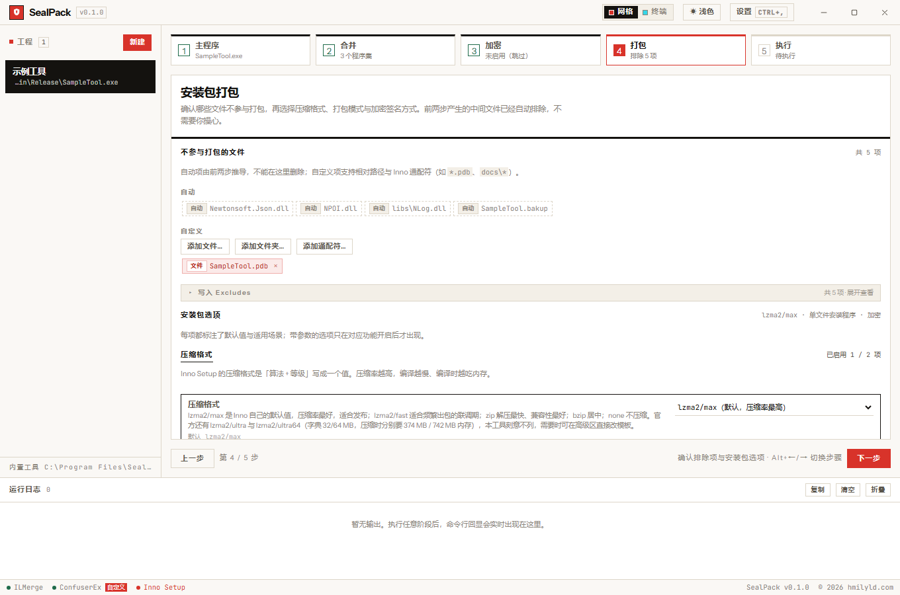
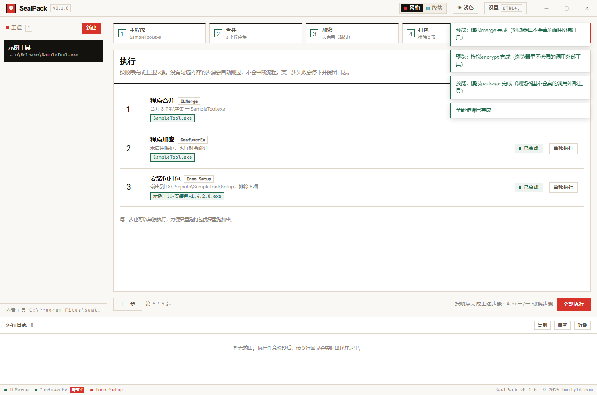
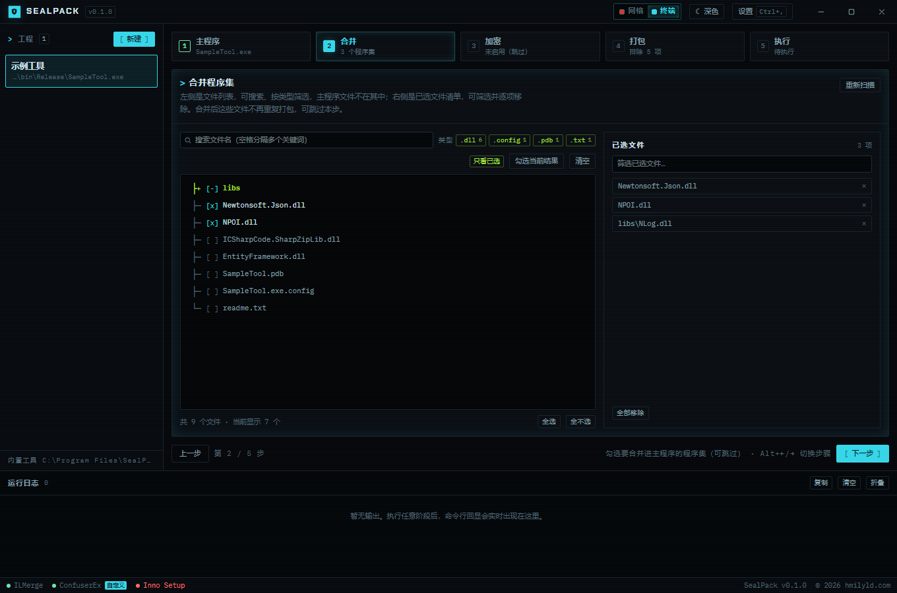
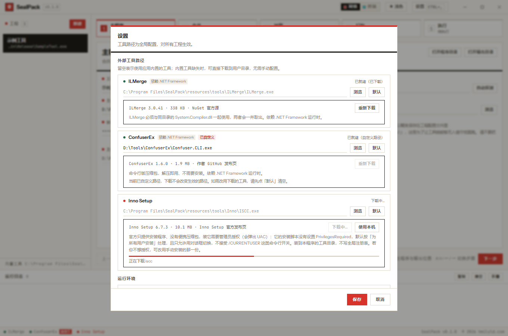

# SealPack

**程序合并 / 加密 / 打包工作台** —— Windows 桌面应用，基于 **Rust + Tauri 2**，前端为原生 TypeScript + TailwindCSS 4。

它把三个成熟的外部命令行工具串成一条可视化的三阶段流水线：

| 阶段 | 工具 | 作用 |
| --- | --- | --- |
| ① 程序合并 | [ILMerge](https://github.com/dotnet/ILMerge) | 把多个程序集合并进主程序，减少分发文件 |
| ② 程序加密 | [ConfuserEx](https://github.com/mkaring/ConfuserEx) | 混淆 + 压缩保护主程序，提升反编译成本 |
| ③ 安装包打包 | [Inno Setup](https://jrsoftware.org/isinfo.php) | 生成安装程序，支持安装口令、整包加密与代码签名 |

> SealPack **不实现任何密码学算法**：混淆由 ConfuserEx 完成、安装包加密由 Inno Setup 完成。
> 它负责的是工程管理、参数编排、模板渲染与实时日志回传 —— 也就是把「读三个工具的文档、手写两份配置」
> 变成「点几下开关」。

① 主程序 · ③ 加密选项 · ④ 打包排除项

⑤ 执行：三步依次跑完，产出文件可直接在资源管理器里定位

设计 3「终端」皮肤（深色）

设置：三个外部工具的路径、下载来源与运行环境自检

---

## 主要功能

- **工程管理** —— 每个工程独立保存主程序、输出目录、安装包口令、版本号、待合并程序集、加密开关、打包选项与排除项，JSON 持久化在应用数据目录。
- **五步向导** —— 主程序 → 合并 → 加密 → 打包 → 执行。步骤条可点、可跳步、可只重跑某一步；每步下面有一行实时摘要。
- **程序合并** —— 带搜索与类型筛选的文件树，勾选待合并的程序集；执行前自动把主程序备份为 `<名称>.bakup`，避免不可逆的原地覆盖。
- **程序加密** —— 分 5 组共 36 个可配置项，覆盖加密算法的三个族：**对称**（常量加密 / 资源加密 / 反篡改）、**非对称**（RSA 强名称签名 `.snk` / `.pfx`）、**哈希**（整模块校验和、口令派生）。每项都标注默认值与适用场景，带参数的选项只在对应保护开启后才出现；另有「不加密 / 基础 / 标准 / 严格」四档一键预设。
- **安装包打包** —— 压缩格式（9 档）、LZMA 字典 / 线程 / 匹配器、三种打包模式（单文件 / 免安装绿色版 / 分卷）、XChaCha20 安装包加密与 PBKDF2-HMAC-SHA256 口令派生、Authenticode 代码签名、SHA-256 / SHA-1 / MD5 产出校验清单。
- **不需要手写模板** —— `.crproj` 与 `.iss` 都由界面上的选项生成；模板编辑器降级为可折叠的「高级」区，默认收起。
- **实时日志** —— 外部工具的 stdout / stderr 逐行推送，自动识别 UTF-8 与 GBK（简体中文 Windows 的 ANSI 代码页）输出。
- **外部工具自举** —— 路径可配置；缺失时可直接下载（URL 与 SHA-256 固定校验），也可一键改用本机已装的那一份。
- **运行环境自检** —— 探测 .NET Framework 4.x，缺失时给出横幅并说明受影响的功能范围。
- **桌面化手感** —— 自绘标题栏与窗口按钮、8 个热区接管无边框窗口的边缘缩放、拦掉浏览器的刷新 / 打印 / 查找 / 缩放 / 拖拽、界面文字默认不可拖选、右键弹出皮肤感知的自绘菜单。
- **两套可实时切换的界面设计** —— 「瑞士技术网格」与「终端」共用同一份 DOM，差异 100% 由 CSS 表达；明暗支持「跟随系统 / 深色 / 浅色」三态。
- **Windows 11 窗口材质** —— 启用 Mica Alt 后标题栏 / 侧栏 / 状态栏半透明；不支持时自动退回实色，也可手动关闭。

## 快速上手

1. 安装并启动 SealPack（NSIS 安装包，安装到当前用户目录，不需要管理员权限）。
2. **新建工程** —— 选择编译输出的 `.exe` 与安装包输出目录；主程序所在目录会成为后续步骤的扫描根目录。
3. **合并**（可跳过）—— 勾选要合并进主程序的程序集。
4. **加密**（可跳过）—— 选一档预设，或逐项微调。
5. **打包** —— 确认不参与打包的文件，选择压缩格式、打包模式、加密与签名。
6. **执行** —— 点「全部执行」按顺序跑完三步，或只跑某一步。

首次运行时若工具链缺失，在**设置**里点「下载」即可；Inno Setup 会尝试静默安装到用户目录（若本机已装有一份，可直接点「使用本机」）。

## 系统要求

- **Windows 10 1809+ / Windows 11**（窗口材质需要 Windows 11）
- **.NET Framework 4.8 或更高** —— ILMerge 与 ConfuserEx 是 .NET Framework 程序；缺失时程序会给出提示，且「合并」与「加密」两步无法执行（「打包」不受影响，Inno Setup 是原生程序）
- WebView2 运行时（Windows 11 自带；Windows 10 由安装包按需安装）

## 文档

| 文档 | 内容 |
| --- | --- |
| [使用指南](docs/guide.md) | 五步向导、文件树、排除项、快捷键、产出校验清单、两套设计 |
| [选项参考](docs/options.md) | 加密与打包的每个选项：默认值、适用场景、会写进模板的指令 |
| [架构与设计决策](docs/architecture.md) | 模块职责、数据流，以及那些「不知道就会改错」的不变量 |
| [开发](docs/development.md) | 环境与命令、构建、测试、界面回归探针、生成器一致性校验 |
| [数据与安全](docs/data-and-security.md) | 数据存放位置、口令存放方式、下载校验、日志打码 |

---

## 许可

[MIT](LICENSE) © hmilyld.com

SealPack 本身不实现密码学算法。它调用的三个外部工具各有自己的许可证，
内置分发的那两个都是 MIT，详见 [`src-tauri/resources/tools/README.md`](src-tauri/resources/tools/README.md)。

[hmilyld.com](https://hmilyld.com/)
